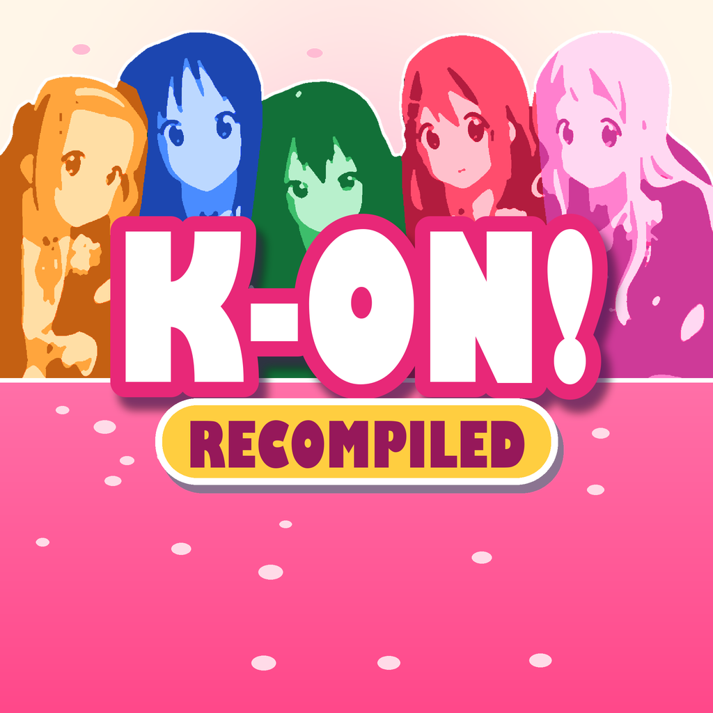

# K-On! Houkago Live!! Recompiled



Port nativo para Windows de **K-On! Hōkago Live!!** (PSP), hecho por
recompilación estática: el código del juego original se traduce a C++ y se
compila para PC, con gráficos Vulkan, FPS altos y resoluciones de PC.

**Este proyecto no incluye el juego.** Ni sus datos ni su código: todo se crea
en tu PC a partir de tu propia ISO, igual que Ship of Harkinian o los
"Recomp" de N64.

*English: native Windows port of K-On! Houkago Live!! (PSP) by static
recompilation. No game data or code is included: download the release, open
the .exe and choose your own ISO (Japanese ULJM05709 or the English fan
translation); the game is translated and compiled on your PC in a few
minutes. Updates install themselves from this repository's releases.*

## Descargar y jugar

1. Descarga `K-On.Houkago.Live.Recompiled-v<versión>-windows.zip` de la
   [última release](../../releases/latest) y descomprímelo donde quieras.
   Todo se guarda dentro de esa carpeta (partidas, ajustes, el juego
   instalado): se puede mover o copiar entera.
2. Abre `K-On Houkago Live Recompiled.exe`.
3. La primera vez te pide tu ISO (o arrástrala encima del .exe). Vale la
   japonesa original (ULJM05709) o la traducción inglesa *K-ON! Houkago
   Live!! / After School Live!!*. Con las dos se puede cambiar el idioma en
   Ajustes (fila «Video»).
4. Después prepara el juego para tu PC: traduce y compila su código. Tarda
   unos minutos y solo pasa la primera vez y tras cada actualización.
5. A partir de ahí, abrir el .exe abre el juego directamente.

Al abrirlo mira si hay una versión nueva en las releases de este repositorio y
pregunta si actualizar (descarga solo lo que cambia; tus partidas se
conservan). `updates=0` en `config/settings.ini` lo desactiva.

Requisitos: Windows 10 u 11 de 64 bits, una GPU con Vulkan y unos 4 GB libres.

## Qué incluye

- 30, 60, 120 y 165 FPS reales con la lógica a la velocidad original, y
  resolución interna hasta 1088p; interfaz y texturas nítidas.
- Japonés e inglés seleccionables en Ajustes.
- Mandos de Xbox, PlayStation, Switch Pro y genéricos, con los iconos del
  botón que usas; teclado y reasignación de botones.
- Multijugador en banda por red local y **online con código de sala** (F8).
- Estado en Discord con la canción que tocas.
- Mods de archivos y de texturas.

Estado: beta. Probado en AMD Radeon 780M, NVIDIA e Intel. Ver el
[roadmap](docs/ROADMAP.md) para lo comprobado y lo pendiente.

## Mandos y teclado

Teclado: flechas, Z (✕), X (○), A (□), S (△), Q/W (L/R), Intro (START),
Retroceso (SELECT). F1: ayuda. F3: mostrar/ocultar FPS. F8: jugar online.
F11 o Alt+Intro: pantalla completa. Mandos: Xbox y compatibles (XInput),
DualShock 4 y DualSense, Switch Pro y mandos genéricos HID/DirectInput,
conectables en caliente. En mandos de Xbox, A acepta y B vuelve.

Para reasignar botones, edita `config/controls.ini` (se crea comentado la
primera vez que arranca el juego): una sección por dispositivo
(`[keyboard]`, `[xbox]`, `[playstation]`, `[nintendo]`, `[generic]`) y líneas
como `circle=K` o `cross=A`.

- [Guía completa de controles](docs/CONTROLES.md)

## Jugar online

Pulsa **F8** dentro del juego para abrir «Jugar online».

1. **Tú:** pulsa **Crear sala**. El juego abre el puerto TCP 41700, pide al
   router por UPnP que lo redirija y muestra el código de la sala (por ejemplo
   `7K2QM-4XH0D`). **Copiar código** lo copia para pasárselo a tu amigo.
2. **Tu amigo:** pulsa F8, escribe el código y pulsa **Unirse**.
3. **Los dos:** entrad en **つうしん! (Local)**. Uno crea la banda como líder y
   el otro se une como miembro, igual que en la PSP.

La primera vez Windows puede pedir permiso al Cortafuegos: acéptalo. No hace
falta ningún servidor: los datos van directamente entre los PC (el de quien
crea la sala hace de punto de encuentro, hasta 5 jugadores).

Si el router no abre el puerto (UPnP desactivado) o tu proveedor comparte la
IP pública (CG-NAT), la ventana lo indica y ofrece alternativas:
- **Código IPv6:** si los dos tenéis IPv6.
- **Código de red local:** sirve en la misma red o con una VPN de juego (Radmin VPN, ZeroTier, Tailscale).
- **Abrir el puerto a mano:** el TCP 41700 en el router.

## Discord

Con Discord abierto en el PC, tu estado muestra que juegas a K-On! Houkago
Live!!, la canción que tocas, la parte, si estás en solitario o con la banda,
y los resultados. No hay que configurar nada. Para desactivarlo: `discord=0`
en `config/settings.ini`. En Discord tiene que estar activado *Ajustes de
usuario → Privacidad de actividad → Compartir tu actividad detectada*.

## Latencia de audio

El sonido sale con unos 46 ms de búfer. Si se oyen cortes, sube
`audio_block_ms` en `config/settings.ini` (por ejemplo `audio_block_ms=46`);
para menos latencia, `audio_block_ms=12`.

## Mods

Cada mod es una carpeta dentro de `mods/` junto al juego:

- `mods/<nombre>/disc/<ruta del disco>` sustituye ese archivo del disco
  (por ejemplo `disc/PSP_GAME/USRDIR/std.cpk`);
- `mods/<nombre>/textures/<hash>.png` (o `.bmp`) sustituye una textura del
  mismo tamaño. Los hashes se obtienen ejecutando el juego con
  `KON_TEXTURE_DUMP=work/texdump`, que guarda cada textura como
  `<hash>_<ancho>x<alto>.bmp`.

Las carpetas se aplican por orden de nombre y la última gana (usa prefijos:
`10-...`, `20-...`). Para desactivar un mod, pon `-` delante de su nombre.

## Problemas

- Si el juego se cuelga, deja `ultimo_fallo.txt` en su carpeta: adjúntalo en
  un [issue](../../issues).
- Si falla la preparación, mira `recomp_cache\compilacion.log`.
- Para reconstruir el juego desde cero, borra la carpeta `recomp_cache`.

## Cómo funciona

- `src/launcher.cpp`: el programa que abre el jugador. Instala la ISO
  (`src/native_install.hpp`), construye el juego (`src/native_build.hpp`) y
  lo actualiza (`src/native_update.hpp`).
- `third_party/PSPRecomp` (con los parches de `tools/`): traduce el ejecutable
  de la PSP a C++. `tools/apply_logic_rate_patch.py` hace que la lógica
  funcione a cualquier FPS.
- `src/boot_probe.cpp` y `src/native_*`: el runtime del port (sistema de la
  PSP, gráficos Vulkan, audio, mandos, red, Discord).
- `tools/make_release.py`: crea los paquetes de una release.

Compilar desde el código requiere las herramientas descritas en
[docs/TOOLCHAIN.md](docs/TOOLCHAIN.md) y [docs/PROCEDENCIA.md](docs/PROCEDENCIA.md)
(zig 0.15.2, CMake, Ninja, cabeceras de Vulkan, FFmpeg, pspdecrypt) y tu
propia ISO:

```powershell
.\tools\build_framework.ps1 -Jobs 8
.\tools\generate_native_code.ps1 -Plain
.\tools\build_native_probe.ps1 -FullAot -Jobs 8
python tools\make_release.py
```

- [Roadmap](docs/ROADMAP.md) · [Plan del port](docs/PLAN_DEL_PORT.md) ·
  [Renderizado Vulkan](docs/RENDERIZADO_VULKAN.md) ·
  [Formatos de recursos](docs/ASSET_FORMATS.md) ·
  [Paquetes de idioma](docs/PAQUETES_DE_IDIOMA.md)

## Licencia

El código de este repositorio está bajo la [licencia MIT](LICENSE).
Componentes de terceros: PSPRecomp (MIT), zig (MIT), CPython (PSF), FFmpeg
(LGPL), pspdecrypt (GPLv3).

K-On! y Houkago Live!! son marcas y obras de sus respectivos propietarios.
Este es un proyecto de aficionados sin relación con ellos y no incluye ningún
contenido del juego: necesitas tu propia copia.
